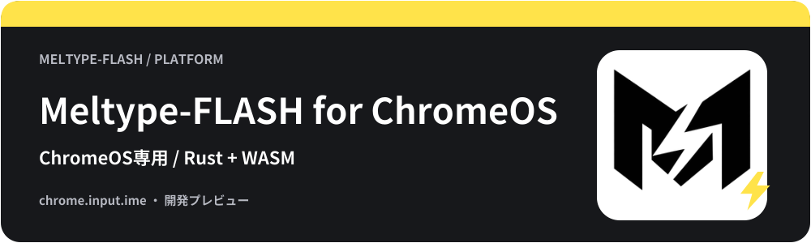

<!-- meltype-flash-platform:start -->
<p align="center"></p>
<a id="meltype-for-chromeos"></a>
<p align="center"></p>
<p align="center"><b>稲妻のように、言葉の壁を駆け抜ける日本語入力。</b></p>
<p align="center"><a href="https://github.com/appipinopi/Meltype-Flash/releases/latest"></a> </p>
<p align="center"><a href="#インストール">ダウンロード・導入</a> · <a href="#使い方">使い方</a> · <a href="#困ったとき">困ったとき</a> · <a href="https://github.com/appipinopi/Meltype-Flash/issues/new/choose">不具合の報告・提案</a></p>
<p align="center">
  <a href="../rust/WINDOWS-PACKAGE.md"></a>
  <a href="../linux/README.md"></a>
  <a href="../mac/README.md"></a>
</p>
<p align="center">
  <a href="../android/README.md"></a>
  <a href="README.md"></a>
  <a href="../ios/README.md"></a>
</p>
<p align="center"><a href="../README.md">トップのREADME</a></p>
<!-- meltype-flash-platform:end -->

ChromeOSの `chrome.input.ime` と共通Rust CoreのWASMを接続する、日本語入力の試験版です。
**通常のWindows・Mac・Linux上のChrome用IMEではありません。Chrome Web Storeへは公開していません。**

<a id="内容"></a>
<h2></h2>

ローマ字・かな、英語・日本語の判定、漢字変換、予測候補、候補選択、設定と学習の保存を接続しています。
AIモデルは「使用しない / shunti」から選べます。shuntiを選択すると導入ボタンを表示し、確認に同意した場合だけ辞書・モデルを別ダウンロードします。パス入力は不要です。Zenzは搭載しません。通常の変換とAI変換は端末内で処理し、入力内容を送信しません。
漢字変換には、固定版Mozcの語彙と接続コストを同梱しています。「にほんご → 日本語」「きょうはいいてんきです → 今日はいい天気です」のように、端末内で変換します。Mozc本体とは異なる上限付きの探索処理であり、候補や順位はデスクトップ版と一致するとは限りません。
設定画面は本家の分類枠・左側の項目名と右側の操作・下部の説明欄に合わせ、「設定」「サイト別設定」「学習とデータ」「使い方」の4ページにまとめています。Flashの表示と、ChromeOS固有のサイト切替・端末内のデータ管理は維持しています。

「設定」で日英判定、句読点、タイプミス補正、Tab変換、英語前後の空白、学習を変更し、下部の「入力設定を保存」で反映します。詳細JSONとも同期します。「保存済み設定へ戻す」で未保存の編集を取り消せます。ページを切り替えても編集中の内容は保持します。タブは左右矢印・Home・Endでも移動でき、項目へフォーカスすると下部に説明を表示します。学習をオフにしても既存の履歴は削除しません。
候補はChromeOS標準の表示を使い、色・フォント・位置の変更は未対応です。[カスタマイズの進め方](../docs/customization.md) に対応範囲と次の案をまとめています。
[導入画面の記録](docs/INSTALLATION.md) はありますが、今回の修正を含む実機での変換・各アプリ入力の確認は未完了です。

[動く環境](#動く環境) · [インストール](#インストール) · [使い方](#使い方) · [困ったとき](#困ったとき) · [アンインストール](#アンインストール) · [開発者向け](#開発者向け)

<a id="動く環境"></a>
<h2></h2>

- `chrome.input.ime` を利用できるChromeOS。
- Manifest V3の拡張機能を手動読込できる環境。
- パッケージの最低Chromeバージョン指定は119。119以降の全版で動作確認した意味ではありません。

管理端末では導入や権限が制限される場合があります。OSのDeveloper Modeへ切り替える手順ではありません。

<a id="インストール"></a>
<h2></h2>

1. [最新正式版](https://github.com/appipinopi/Meltype-Flash/releases/latest) から `Meltype-flash-ChromeOS.zip` を取得し、フォルダーへ全体展開します。
2. ChromeOSの `chrome://extensions` を開き、拡張機能の「デベロッパーモード」を有効にします。
3. 「パッケージ化されていない拡張機能を読み込む」で、`manifest.json` のあるフォルダーを選びます。
4. ChromeOSの言語・入力方法の設定からMeltypeを追加し、入力方法として選びます。

表示名は `Meltype-FLASH` です。旧版では `Meltype Rust` と表示します。[画像付きの導入案内](docs/INSTALLATION.md) は旧版の画面ですが、追加する経路は同じです。
既存版を更新する場合は、先に設定画面で必要なスナップショットを保存します。同じフォルダーを新しいファイルで更新し、拡張機能を再読み込みしてください。学習を残したい場合は、先に拡張機能を削除しないでください。

<a id="自動更新"></a>
<h3>自動更新</h3>

リリースには、署名した `Meltype-flash-ChromeOS.crx` と更新マニフェスト `updates.xml` を添付しています。拡張機能の `update_url` は `https://github.com/appipinopi/Meltype-Flash/releases/latest/download/updates.xml` です。CRXを管理者ポリシー（`ExtensionInstallForcelist` など）で導入した場合、Chromeが新しい版を自動で取得します。

CRXは管理者ポリシーで導入するためのファイルです。`chrome://extensions` へドラッグして手動で入れることはできません（[CRX_REQUIRED_PROOF_MISSING](#crx-required-proof-missing)）。通常は下のZIPの手順を使ってください。

ZIPを「パッケージ化されていない拡張機能」として読み込んだ場合も、CRXを使わずに更新できます。設定画面の「学習とデータ」→「更新を確認」で新しい版を確認し、「ZIPで更新（CRXなし）」で拡張機能のフォルダーを選ぶと、配布ZIPの内容をSHA-256で確認してから書き込みます。書き込み後に「拡張機能を再読み込み」を押してください。フォルダーを選べない環境では、ZIPを展開して同じフォルダーへ置き換えてから再読み込みします。確認には `api.github.com` と配布ファイルへの接続許可が必要です。入力内容は送信しません。

<a id="使い方"></a>
<h2></h2>

| 操作 | 動作 |
| --- | --- |
| 文字キー | 共通Coreでローマ字・かなと英語を判定 |
| 半角/全角 / Alt+Backquote | 日本語と半角英数を切替。未確定入力は確定してから切替。通常のBackquoteは記号として入力。 |
| Space | 変換・候補切替 |
| 候補クリック / Enter | 候補を選択して確定 |
| Esc | 取消 |
| F6 / F7など | 対応する字種へ切替。OSに取られるキーは届かない場合があります。 |

例: `hashi` → Space → 「橋」「箸」の候補を選択 → Enterで確定。

ChatGPTなどのチャット欄では、`chatgptwotsukau` → Space → `chatgptを使う` → Enterで確定します。英字の文節はそのまま残し、日本語の文節を変換します。複数文節の候補は選択中の文節に対するものです。左右キーで文節を選び、Enterで文全体を確定できます。未確定入力がある間のCtrl+Enterは確定だけを行い、次のCtrl+Enterをアプリへ渡します。この手順は実WASMと模擬IME APIで検証しており、ChromeOS実機のChatGPT画面での確認は未実施です。

ChromeOSの入力方式切替はOS側の設定を使います。

<a id="サイトごとの通常入力コード入力"></a>
<h3></h3>

初期状態ではサイト別の自動切替は無効です。「サイト別設定」ページで「サイトごとの自動切替」を有効にし、必要なタブ参照を許可して「入力モードを保存」を押します。
`vscode.com`・`vscode.dev`・`github.dev` は初期候補です。権限を許可しない場合は手動の入力モードを使えます。
周辺テキストを渡さないエディターではコメント・文字列の判定ができないため、そのサイトは通常入力へ切り替えてください。
サイト別設定はCoreの学習スナップショットとは別で、現在のJSON書き出しには含まれません。

<a id="プライバシー"></a>
<h2></h2>

入力と変換は拡張機能内のWASMで処理し、設定・学習は `chrome.storage.local` に保存します。学習禁止やシークレットでは保存を抑止します。
初回の設定画面で同意したあと、利用状況（アプリの版・OSの版・起動回数・画面を開いた回数）をAptabaseへ匿名で送ります。入力内容・入力履歴・辞書・設定値・入力欄の文字列は送りません。同意後の送信は停止できません。
サイト別切替の任意権限 `tabs` は、現在のタブを調べるために使います。ページへ入力用スクリプトを挿入する構成ではありません。
拡張機能の削除でローカルデータを失うため、必要なスナップショットは先に保存してください。

<a id="困ったとき"></a>
<h2></h2>

<a id="crx-required-proof-missing"></a>
<details>
<summary>「CRX_REQUIRED_PROOF_MISSING」と出てCRXをインストールできない</summary>

CRXファイルが壊れているわけではありません。Chrome Web Storeを通さない自己署名CRXには、Chromeが要求する発行元の証明（proof）がないため、Chromeが仕様として手動インストールを拒否しています。Web Storeで公開していない拡張機能では、この表示が正常です。

1. **通常はZIPで入れる**：上の「インストール」の手順どおりZIPを展開し、`chrome://extensions` のデベロッパーモードで「パッケージ化されていない拡張機能を読み込む」から `manifest.json` のあるフォルダーを選びます。
2. **CRXで自動更新したい場合**：端末の管理ポリシーで `ExtensionInstallForcelist` を設定します。値は `拡張機能ID;https://github.com/appipinopi/Meltype-Flash/releases/latest/download/updates.xml` です。拡張機能IDは、リリースの `updates.xml` にある `<app appid="...">` で確認できます。ChromeOSの管理端末では、管理者がGoogle管理コンソールの「アプリと拡張機能」からURLを指定して強制インストールする方法でも同じです。
3. **Web Storeから入れる**：Meltype-FLASHはChrome Web Storeへ公開していないため、Web Store経由ではインストールできません。

CRXをダブルクリックしたり `chrome://extensions` へドラッグしたりする方法は、Chromeの仕様で使えません。デベロッパーモードでも、この手動CRXインストールは許可されません。

</details>

<details>
<summary>拡張機能として入ったのに入力方法が出ない</summary>

ChromeOSであること、OS側の入力方法へ追加したこと、管理ポリシーで許可されていることを確認します。
通常のデスクトップChromeではこのIME APIを使えません。拡張機能画面に表示されるだけでIME対応とは判断できません。

</details>

<details>
<summary>英字のまま・候補が出ない・設定が切り替わらない</summary>

まずSpaceで候補を確認します。サイトの周辺文字が取れない場合は通常入力へ変更し、更新後は拡張機能を再読み込みしてください。
旧版は補助辞書しか接続しておらず、「橋」など一部の語以外は漢字候補が出ませんでした。修正版では `pkg/kanji.bin` も必要です。JSやWASMだけを個別にコピーせず、同じ拡張機能フォルダーをZIPの全内容で更新してから、拡張機能を再読み込みしてください。
OS・拡張機能の版・サイト・入力手順を [Issues](https://github.com/appipinopi/Meltype-Flash/issues/new/choose) に記載してください。タブURLや文章に個人情報がないか確認してください。

</details>

<a id="アンインストール"></a>
<h2></h2>

入力方法を別のものへ切り替え、ChromeOSの入力方法一覧からMeltypeを外してから、`chrome://extensions` で拡張機能を削除します。
削除前に必要な設定・学習スナップショットを保存してください。展開フォルダーも不要になってから削除します。

<a id="開発者向け"></a>
<h2></h2>

Rustと `wasm-bindgen-cli`、Pythonが必要です。リポジトリのルートから実行します。
初回ビルドでは `native/mozc/MOZC_COMMIT` に固定したMozcの辞書と接続コストを取得します。取得したデータは `tools/data/chromeos-mozc/<commit>/` に保存し、次回から再利用します。実行時の外部通信は不要です。

```sh
python chromeos/build.py
```

`dist/chromeos-preview` と同名ZIPを作ります。別のwasm-bindgen実行ファイルは `--wasm-bindgen`、出力先は `--out` で指定します。`CARGO_TARGET_DIR` も尊重します。
実WASMでの変換・候補・学習復元、模擬IME APIでの順序・UTF-16位置・競合・エラーを検査します。
模擬APIでの成功とChromeOS実機での成功は別です。[移行記録](../rust/MIGRATION.md) と [ビルドスクリプト](build.py) も参照してください。
パッケージ内の `pkg/MOZC-DICTIONARY-NOTICES.txt` に、辞書の出典・固定commit・取得ファイルのSHA256・ライセンス本文を含めています。

<a id="ライセンス"></a>
<h2></h2>

[GPL-3.0-or-later](../LICENSE)。ZIPにはライセンス・第三者表示・解決済み依存関係の表示を同梱します。[THIRD-PARTY-NOTICES.md](../THIRD-PARTY-NOTICES.md) を参照してください。

<a id="101のキーボード配列"></a>
<h2></h2>

ChromeOSの入力方法で「Meltype-FLASH（日本語配列）」または「Meltype-FLASH（US配列）」を選んでください。既存の入力方法は日本語配列へ更新されます。USキーボードの場合はUS配列を追加して選び直してください。日本語配列では半角／全角、US配列ではAlt+Backquoteで英数・日本語を切り替えます。
