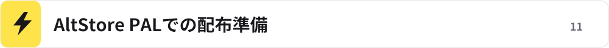
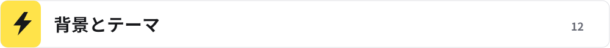
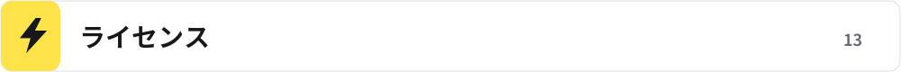

<!-- meltype-flash-platform:start -->
<p align="center"></p>
<a id="meltype-for-ios"></a>
<p align="center"></p>
<p align="center"><b>稲妻のように、言葉の壁を駆け抜ける日本語入力。</b></p>
<p align="center"><a href="https://github.com/appipinopi/Meltype-Flash/releases/tag/flash-v0.1.0-preview.7"></a> </p>
<p align="center"><a href="#インストール">ダウンロード・導入</a> · <a href="#使い方">使い方</a> · <a href="#困ったとき">困ったとき</a> · <a href="https://github.com/appipinopi/Meltype-Flash/issues/new/choose">不具合の報告・提案</a></p>
<p align="center">
  <a href="../rust/WINDOWS-PACKAGE.md"></a>
  <a href="../linux/README.md"></a>
  <a href="../mac/README.md"></a>
</p>
<p align="center">
  <a href="../android/README.md"></a>
  <a href="../chromeos/README.md"></a>
  <a href="README.md"></a>
</p>
<p align="center"><a href="../README.md">トップのREADME</a></p>
<!-- meltype-flash-platform:end -->

iPhone・iPadのカスタムキーボードとして動く、Rust版Meltype-flashの初期プレビューです。
**未確定文字はキーボードの中に表示し、確定した文字だけを入力欄へ送ります。**

<a id="内容"></a>
<h2></h2>

QWERTY入力、12キーのかなフリック、英語・日本語の判定、補助辞書による候補、空白・削除・確定を実装しています。
AI変換は搭載しません。通常の辞書変換と予測候補は端末内で処理します。
デスクトップの外部変換エンジン、翻訳、アプリ別設定、学習・入力設定の永続保存は未対応です。背景・テーマは本体アプリで設定し、端末内に保存できます。
実機の各アプリでの入力やApp Store審査を完了した製品ではありません。

[動く環境](#動く環境) · [インストール](#インストール) · [使い方](#使い方) · [困ったとき](#困ったとき) · [アンインストール](#アンインストール) · [開発者向け](#開発者向け)

<a id="動く環境"></a>
<h2></h2>

- iOS 15以降のiPhone / iPad。
- 実機へ導入するには自分の署名が必要です。
- Simulator向けZIPはApple Silicon MacのiOS Simulator用で、iPhoneへは入りません。

iOS側が標準キーボードへ切り替えるパスワード欄や、外部キーボードを禁止したアプリでは使えません。

<a id="インストール"></a>
<h2></h2>

[FlashのPre7](https://github.com/appipinopi/Meltype-Flash/releases/tag/flash-v0.1.0-preview.7) の配布から、目的に合うものを選びます。

| ファイル | 用途 |
| --- | --- |
| `Meltype-flash-iOS-unsigned.ipa` | 自分のApple IDなどで署名して実機へ導入するための未署名IPA |
| `Meltype-flash-iOS-source.zip` | Xcodeで自分のチーム・Bundle Identifierを設定してビルドするためのソース |
| `Meltype-flash-iOS-Simulator-arm64.zip` | Apple Silicon MacのSimulator向け。実機には非対応 |

IPAをファイルアプリで開いたり、ZIPの拡張子を変更したりするだけでは導入できません。

<a id="windowsから自分のiphoneへ入れる"></a>
<h3></h3>

1. [AltStore ClassicのWindows向け公式手順](https://faq.altstore.io/altstore-classic/how-to-install-altstore-windows) に従い、必要なApple製ソフトとAltServerをPCに用意します。
2. iPhoneをUSB接続し、「このコンピュータを信頼」を許可してAltStore Classicを導入します。Apple IDはAltServer / AltStoreの画面で扱います。
3. 必要に応じてiPhoneの「VPNとデバイス管理」で開発元を信頼し、iOSの案内に従ってデベロッパモードを設定します。
4. AltStore Classicの「My Apps」の＋から未署名IPAを選びます。**アプリ拡張を選べる場合はキーボード拡張を残してください。削除するとキーボードとして使えません。**
5. 署名に使うアカウントの更新期限・App ID枠を確認し、必要な更新を続けます。

AltStore PALとは別の導入方法です。[更新と制限](https://faq.altstore.io/altstore-classic/your-altstore)、[App IDの説明](https://faq.altstore.io/altstore-classic/app-ids) も参照してください。
この経路による実機入力は未検証です。署名・導入サービス側の画面や条件は公式の案内を優先してください。

<a id="altstore-palでの配布準備"></a>
<h3></h3>

Pre6で追加した[署名・公証・PALソースJSONの生成手順](ALTSTORE-PAL.md)を用意しています。PALへの公開はまだ完了していません。有料のApple Developer登録とAppleの公証が必要で、上記の未署名IPAはPALへ直接登録できません。この準備では版番号や公開タグを変更しません。

<a id="キーボードを有効にする"></a>
<h3></h3>

導入後は「設定 → 一般 → キーボード → キーボード → 新しいキーボードを追加」からMeltype-flashを追加し、入力欄で🌐から選びます。
**フルアクセスの許可は不要です。**

アプリにはロゴ、設定を開くボタン、入力テスト、背景・テーマ設定があります。
「設定を開く」はアプリの設定を開きます。キーボードの追加はiOSの設定画面で行ってください。
起動時にキーボード拡張の同梱状態を確認し、削除されている場合は再導入の案内を表示します。
拡張の同梱表示は、署名の有効性やiOS側の有効化を保証するものではありません。

<a id="背景とテーマ"></a>
<h3></h3>

本体アプリの「キーボードの背景・テーマ」を開き、システム・ライト・ダーク・ブルー・ピンク・ミントから配色を選びます。「好きな画像を選ぶ」で写真の選択画面を開き、1枚を背景にできます。画像は長辺1280ピクセル以下へ縮小して端末内に保存し、中央基準で切り抜いて表示します。キーボードを開き直すと反映されます。

「背景画像を外す」は画像だけを削除し、テーマは保持します。背景の設定は変換の学習や入力履歴とは別です。キーボードは本体アプリの共有領域から読み取るだけで、`RequestsOpenAccess: false` を維持しています。[Appleの共有領域・フルアクセスの説明](https://developer.apple.com/documentation/uikit/configuring-open-access-for-a-custom-keyboard) を参照してください。

背景の共有には、本体アプリとキーボードの両方で同じApp Groupを署名へ含める必要があります。自分のチームで署名するときは、`ios/project.yml` の `MELTYPE_APP_GROUP` を利用可能なグループIDへ変更し、両方のApp IDとプロビジョニングプロファイルへ登録してください。共有領域を利用できない場合、設定画面にその旨を表示し、キーボードは標準配色で動きます。この追加機能のiOSビルド・Simulator・実機確認は未実施です。

<a id="使い方"></a>
<h2></h2>

アプリ内のホームの入力テストとフリックのお試し画面では、入力した文字を長押し・選択するとiOS標準の編集メニューが開きます。コピー・切り取り・ペースト・全選択は標準機能を使います。
選択メニューの「Meltypeで変換」から候補を選ぶと、選んだ範囲だけを置き換えます。「キャンセル」なら元の文字を残します。「選択範囲を削除」で選んだ部分をまとめて消せます。範囲や文章が変わった場合は置き換えません。
他のアプリの編集メニューは、そのアプリが管理します。Meltypeキーボードでは、文字を選択して「空白・変換」を押すと再変換できます。未確定欄の長押しから変換を取り消せます。

上部の「かなフリックに切替」で12キー配列へ、「ABC・QWERTYに切替」で英数字配列へ切り替えます。切り替え時の未確定文字は確定し、選んだ配列はキーボード内に保存します。
かなキーはタップで中央、左・上・右・下へのフリックで別の文字を入力します。「あ」は順に「あ・い・う・え・お」です。指を中央へ戻すと中央の文字に戻り、操作がキャンセルされた場合は入力しません。
「゛小゜」は未確定の最後のかなを濁点・半濁点・小文字へ切り替えます。例: は → ば → ぱ → は。確定済みの入力欄の文字には作用しません。
「空白・変換」で候補を出し、候補の選択か「確定 ↵」で確定します。アプリ内の「フリック入力を試す」でも同じ操作を試せます。

文字キーで入力し、キーボード上部の未確定表示と候補を確認します。候補の選択または確定ボタンで入力欄へ送ります。
空白・削除などはキーボード上のボタンを使い、🌐から別のキーボードへ戻れます。
入力欄を移動すると未確定入力を破棄し、確定済みの文字をさかのぼって修正しません。

<a id="プライバシー"></a>
<h2></h2>

入力内容を通信・記録する機能はありません。アプリ内のコピー・ペーストはユーザーが標準メニューから操作したときにiOSが処理します。入力履歴や学習は保存しません。選んだ配列はキーボード内に保存します。
キーボードの制限はiOSと使用中のアプリの挙動にも従います。
署名・アプリ導入に使うApple IDや認証情報を不具合報告へ添付しないでください。

<a id="困ったとき"></a>
<h2></h2>

<details>
<summary>キーボード一覧に出ない</summary>

アプリ本体だけでなく、キーボード拡張も署名・導入されているか確認してください。AltStoreで拡張を外した場合はキーボードを追加できません。
Simulator用ZIPを実機に使っていないかも確認してください。

**iPASideで導入した場合**: [iPASide公式README](https://github.com/pwnapplehat/iPASide#what-apples-free-account-will-not-let-you-do) は、拡張が通常削除され、キーボードなどが使えなくなると説明しています。
配布IPAに含まれる `PlugIns/MeltypeFlashKeyboard.appex` を署名時に削除すると、起動画面だけは開けてもキーボード一覧には出ません。
アイコンの有無とは別の問題で、アプリ画面の操作だけでは削除された拡張を復元できません。
拡張を保持して本体・拡張の両方を署名できる方法で再導入してください。AltStore Classicを使う場合も、拡張を削除せずに導入する必要があります。

</details>

<details>
<summary>アプリによって標準キーボードに戻る・入力できない</summary>

iOSはパスワード欄などで標準キーボードへ切り替えます。ホストアプリが外部キーボードを拒否する場合もあります。
通常のテキスト欄でも再現する場合は、iOS・アプリ名・導入した版・入力手順を [Issues](https://github.com/appipinopi/Meltype-Flash/issues/new/choose) に記載してください。

</details>

<a id="アンインストール"></a>
<h2></h2>

設定のキーボード一覧からMeltype-flashを外し、ホーム画面またはアプリ一覧からアプリ本体を削除します。
署名・更新に使った導入サービス側の登録やデータの扱いは、そのサービスの案内に従ってください。

<a id="開発者向け"></a>
<h2></h2>

MacにXcode、Rust、XcodeGenを用意し、リポジトリのルートから実行します。

```sh
bash ios/build.sh
```

Apple SiliconのSimulator向けZIPと未署名の実機向けアプリを作ります。
IPAの作成時にアイコン用アセット、キーボード拡張、拡張のエントリーポイント、Bundle Identifier、本体と拡張のバージョン一致を検査します。
アイコンは既存のFlashマークを使っています。原本を更新した場合はPillowを用意して `python3 ios/make-assets.py` を実行し、生成された `ios/Assets.xcassets` も保存してください。通常のビルドは保存済みアセットを使います。
実機用は `ios/MeltypeFlash.xcodeproj` をXcodeで開き、アプリ本体とキーボード拡張の両方へ自分の開発チームと固有のBundle Identifierを指定して署名します。
TestFlight / App Store配布には配布署名とプロビジョニングが必要です。このリポジトリから署名済みIPAやApp Store公開は行っていません。
Rust ABIの入力・確定・長文・セッション分離と、Xcodeのビルド検証を行います。実機のメモリー使用量や各アプリとの相性は別途確認が必要です。
Appleの [カスタムキーボード資料](https://developer.apple.com/documentation/uikit/creating-a-custom-keyboard) も参照してください。

<a id="ライセンス"></a>
<h2></h2>

[GPL-3.0-or-later](../LICENSE)。辞書などの表示は [THIRD-PARTY-NOTICES.md](../THIRD-PARTY-NOTICES.md) を参照してください。
