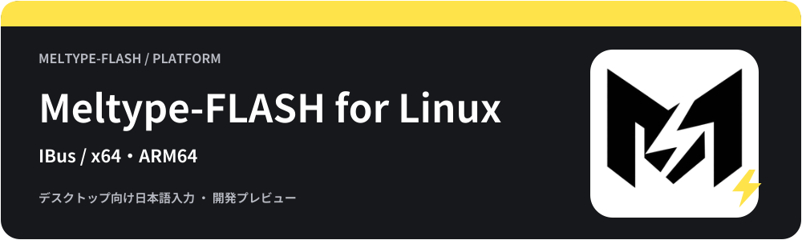

<!-- meltype-flash-platform:start -->
<p align="center"></p>
<a id="meltype-for-linux"></a>
<p align="center"></p>
<p align="center"><b>稲妻のように、言葉の壁を駆け抜ける日本語入力。</b></p>
<p align="center"><a href="https://github.com/appipinopi/Meltype-Flash/releases/tag/flash-v1.1.0"></a> </p>
<p align="center"><a href="#インストール">ダウンロード・導入</a> · <a href="#使い方">使い方</a> · <a href="#困ったとき">困ったとき</a> · <a href="https://github.com/appipinopi/Meltype-Flash/issues/new/choose">不具合の報告・提案</a></p>
<p align="center">
  <a href="../rust/WINDOWS-PACKAGE.md"></a>
  <a href="README.md"></a>
  <a href="../mac/README.md"></a>
</p>
<p align="center">
  <a href="../android/README.md"></a>
  <a href="../chromeos/README.md"></a>
  <a href="../ios/README.md"></a>
</p>
<p align="center"><a href="../README.md">トップのREADME</a></p>
<!-- meltype-flash-platform:end -->

Linuxの入力ソースとして使うRust版Meltype-FLASHです。**公開プレビューはRust製IBusエンジン**です。
fcitx5アダプターのソースと試験はありますが、公開IBusパッケージにfcitx5版は同梱していません。

<a id="内容"></a>
<h2></h2>

ローマ字・かな入力、英語・日本語の判定、補助辞書による漢字候補、確定、設定・学習・辞書保存を共通Coreへ接続しています。
公開版はMozcヘルパーを同梱しています。Zenzai・shuntiのAI変換は任意導入で、標準では無効です。

[動く環境](#動く環境) · [インストール](#インストール) · [使い方](#使い方) · [困ったとき](#困ったとき) · [アンインストール](#アンインストール) · [開発者向け](#開発者向け)

<a id="動く環境"></a>
<h2></h2>

- x64向けのdeb・rpm・tar.gz。ARM64版は1.0.6に添付していません。
- debはUbuntu 24.04以降向け、rpmはglibc 2.39以降のRPM系環境向けです。
- IBusを使用するデスクトップ環境。GNOMEの「日本語入力」などへ追加します。
- システムのIBus / GLibと、設定画面を動かすGUI環境。

他のディストリビューションや、Wayland / X11・GTK / Qtの組合せすべてでの動作を保証するものではありません。
fcitx5を使う環境は、下記のソースビルドと開発状況を参照してください。

<a id="インストール"></a>
<h2></h2>

<a id="ubuntu向けdeb"></a>
<h3></h3>

[1.1.0](https://github.com/appipinopi/Meltype-Flash/releases/tag/flash-v1.1.0)のAssetsから、環境に合う形式を1つ選びます。同じ1.1.0のLinuxバイナリを収めています。AIモデルの選択・任意導入は[AIの案内](../rust/AI-MODELS.md)を参照してください。

**Ubuntu 24.04以降（deb）**

`Meltype-flash-Linux-x64.deb`をダウンロードしたフォルダーで実行します。依存パッケージはaptが解決します。

```sh
sudo apt install ./Meltype-flash-Linux-x64.deb
```

**RPM系環境（glibc 2.39以降）**

`Meltype-flash-Linux-x64.rpm`をダウンロードしたフォルダーで実行します。依存パッケージはdnfが解決します。

```sh
sudo dnf install ./Meltype-flash-Linux-x64.rpm
```

**tar.gzから導入する場合**

`Meltype-flash-Linux-x64.tar.gz`を全体展開し、`Meltype-flash-linux`フォルダーで実行します。

```sh
bash install.sh
```

導入後はログアウト・ログインし、OSのIBus入力ソースにMeltype-FLASHを追加して選びます。標準の配布物は補助辞書による変換に制限があります。

<a id="使い方"></a>
<h2></h2>

入力ソースをMeltype-FLASHへ切り替え、テキスト欄にローマ字を入力します。

| キー | 操作 |
| --- | --- |
| Space | 変換・候補の切替 |
| Enter | 確定 |
| Esc | 取消 |
| ← / → | 変換中の文節選択 |
| F6〜F10 | ひらがな・カタカナ・英数などの字種切替 |

補助辞書による候補を確認する例は `hashi` → Space → 「橋」「箸」などを選んでEnterです。
入力ソースの切替キーはOS側の設定を使います。
GNOMEの入力ソースにある「設定」からも設定画面を開けます（この修正を含むZIP・debを導入した場合）。
設定アプリは `meltype-flash`、共通CLIは `meltype-rs` です。インストール形式によってはフルパスで起動します。
アプリ別設定は [専用の案内](../rust/APP-RULES.md) を参照してください。IBusがアプリ名を渡さない経路では、自動切替を行いません。

<a id="プライバシー"></a>
<h2></h2>

共通Coreのデータは `${XDG_DATA_HOME:-~/.local/share}/Meltype-flash` に保存します。`MELTYPE_FLASH_DATA_DIR` で明示した保存先はそちらを優先します。
通常の変換はローカルで処理します。設定・学習・辞書のバックアップには個人の語句が含まれる場合があります。
初回起動の同意画面で同意したあと、Aptabaseへ匿名の利用回数（アプリの版・OSの版・起動回数）を設定画面から送ります。入力内容・入力履歴・辞書・設定値は送りません。この送信は設定から停止できません。

<a id="困ったとき"></a>
<h2></h2>

<details>
<summary>入力ソースに出てこない</summary>

まずIBusを使う環境か、導入後にログインし直したかを確認してください。
ユーザー領域への導入ではIBusが追加のコンポーネント検索パスを必要とするため、通常の導入は上記のシステム導入を使います。
`fcitx5` の設定画面にIBus版を追加することはできません。

</details>

<details>
<summary>変換の候補が少ない・アプリによって入力できない</summary>

Mozcヘルパーが起動できない場合は補助辞書へ戻ります。OS・デスクトップ・Wayland/X11・アプリ名・入力例を [Issues](https://github.com/appipinopi/Meltype-Flash/issues/new/choose) に添えてください。
端末や入力方式の違いを確かめるため、別の一般的なテキスト欄でも結果を比較してください。

</details>

<a id="アンインストール"></a>
<h2></h2>

先にOSの入力ソースを別のものへ切り替え、Meltype-FLASHを入力ソース一覧から外します。

debで導入した場合:

debにはアプリセンター向けのAppStreamカタログとアイコンを同梱します。debの管理一覧に対応したUbuntuのアプリセンターでは、導入後にアプリセンターを開き直し、「管理」のdeb一覧からMeltype-FLASHを探します。古いアプリセンターではdebが管理一覧に表示されない場合があります。その場合も次のコマンドで削除できます。

この登録は導入済みアプリの管理用です。未導入のPCで検索して入手するには、別途Ubuntuの配布リポジトリーやストアへの登録が必要です。

```sh
sudo apt remove meltype-flash
```

rpmで導入した場合:

```sh
sudo dnf remove meltype-flash
```

tar.gzの `--system` で導入した場合:

```sh
sudo bash /usr/libexec/meltype-flash/ibus/install.sh --system --uninstall
```

個人の設定・学習は残ります。必要なデータを保存してから、削除するか判断してください。

<a id="開発者向け"></a>
<h2></h2>

<a id="ソースからビルドする"></a>
<h3></h3>

Rust 1.88以上、Cリンカー、IBus / GLibの開発用パッケージが必要です。リポジトリのルートで実行します。

```sh
cargo test -p meltype-core --locked
bash rust/build-linux.sh
```

`linux/build/Meltype-flash-linux` とtar.gzを作成します。ビルドだけではインストールしません。
Mozcヘルパーがない場合は、補助辞書によるパッケージを作ります。
fcitx5のRustアダプターは `linux/fcitx5` にあり、必要な開発用ライブラリとCMakeを使います。[Rust用CI](../.github/workflows/rust.yml) と [移行記録](../rust/MIGRATION.md) を参照してください。
本家向けの `linux/build.sh` / `linux/install.sh` とFlashの上記スクリプトを取り違えないでください。

<a id="ターミナルと追加の切替キー"></a>
<h3></h3>

ターミナルは英数のコード入力を既定にします。半角/全角でその入力行を日本語にし、もう一度押すと英数へ戻せます。カーソル移動・Tab・Ctrl操作で入力欄へキーを渡した場合や、フォーカスを移した場合は、コード入力へ戻ります。

Rust版IBusとfcitx5では、既存の設定 `ToggleKeyboardShortcuts` に `Shift+Space; Ctrl+Space` のように指定すると、それらを切替キーとして処理します。切替時は表示中の入力を一度だけ確定し、余分な空白を挿入しません。設定が空なら、Shift+Spaceの従来の動作を保ちます。

IBusはWSLの隔離したXvfb・D-Bus環境でも検証しています。通常のデスクトップや各アプリでの実機確認とは区別してください。

<a id="ライセンス"></a>
<h2></h2>

[GPL-3.0-or-later](../LICENSE)。辞書と依存ライブラリのライセンスは [THIRD-PARTY-NOTICES.md](../THIRD-PARTY-NOTICES.md) を参照してください。

<a id="101の漢字変換"></a>
<h2></h2>

正式配布にはMozc変換ヘルパーとライセンスを同梱します。1.0.0でひらがなのまま変換できなかった場合は、1.0.6のパッケージ全体を更新し、サインアウト・サインイン後にMeltype-FLASHを選び直してください。ソースビルドでは先に `bash native/mozc/build-mozc-helper.sh` を実行し、`MELTYPE_REQUIRE_MOZC=1 bash rust/build-linux.sh` で同梱を確認できます。

## 1.0.6のLinux機能

設定画面の下部に現在の版と「アップデート」「バージョン情報」を表示します。「アップデート」で確認し、「ダウンロード・更新」でOSの認証後に導入します。パッケージ管理が成功した場合だけ完了を表示します。

Ubuntu x64のdebは署名付きAPT更新元 `https://appipinopi.github.io/Meltype-Flash/apt` と、この更新元だけに使う公開鍵を登録します。以後はUbuntuの更新確認からも新しい版を取得できます。debを削除すると、このパッケージが所有する更新元・公開鍵も削除されます。Meltypeの手動／自動設定はMeltype自身の更新確認に適用され、Ubuntu側の更新設定はUbuntuで管理します。

Ubuntu App Centerのカタログ読み込み先に合わせた互換用データも同梱します。導入後にアプリセンターを開き直し、「管理」のdeb一覧でMeltype-FLASHを検索してください。

### 任意導入のAI変換

- Zenzaiは「Zenzaiを使う」を選び、確認画面で許可した場合だけ、CPU実行環境とGGUFモデルを個人領域へ取得します。
- shuntiは「shunti AI変換を使う」を選び、確認後に別配布の `Meltype-flash-Shunti-Linux-x64.tar.gz` と上流の辞書・モデルを取得します。Linux x64専用です。コードはMIT、辞書はCC BY-SA 4.0、モデルはCC BY 4.0で、追加パッケージ内の文書に出典・詳細を同梱します。上流は [shunti IME](https://github.com/shuntilettuce/Japanese-IME-for-HarmonyOS-next) です。
- どちらも本体にはAIの重みを含めません。Ollama・Docker・Python仮想環境や、利用者側でのコンパイラー導入は不要です。Zenzaiとshuntiは選択して使用します。「OK」で設定を保存すると入力へ反映します。
- AI変換の取得失敗・応答失敗時は標準のMozc変換を維持します。環境作成時はSHA-256を検査し、shuntiは実変換も検査します。作成済みファイルが変更されている場合は再利用しません。

1.0.6のベンチマークは、AI・外部変換・IBus・GUIを含まない共通CoreをLinuxで測定します。AIの速度・精度を示すものではありません。
